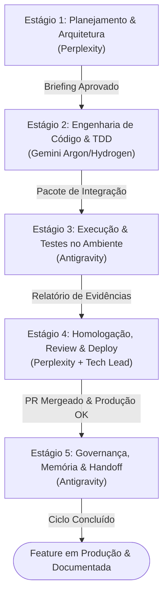

# Triad AI Orchestration — Framework Multi-Agente de Alta Precisão

> "Perplexity planeja e homologa; Gemini Argon/Hydrogen modelam e codificam; Antigravity executa, testa e integra; Tech Lead valida e decide."

---

## 🎯 1. Objetivo e Quando Ativar

Esta skill estabelece uma esteira de engenharia de software distribuída entre inteligências artificiais com especialidades complementares, eliminando o desperdício de tokens, alucinações de escopo e código genérico não testado.

### Frases de Ativação
Ative esta skill sempre que o usuário/Tech Lead disser:
- *"Iniciar fluxo tríade"*
- *"Orquestrar com Perplexity e Argon"*
- *"Executar ciclo tríade"*
- *"Planejar e implementar com a tríade"*
- *"Ativar triad-ai-orchestration"*
- *"Briefing técnico para o Argon"*
- *"Preparar handoff Argon ➔ Antigravity"*
- *"Homologar entrega tríade"*
- *"Atualizar ADRs e handoff"*

---

## 🧠 2. Princípios Fundamentais (Invariantes Operacionais)

1. **Simplicidade de Karpathy:** Prefira sempre a menor solução correta, legível e manutenível. Rejeite abstrações prematuras, camadas desnecessárias ou bibliotecas supérfluas.
2. **Honestidade Absoluta de Dados:** Nenhuma métrica, teste, cobertura, status de deploy ou evidência pode ser afirmada sem execução factual verificada no ambiente. Proibido forjar dados ou assumir que algo funciona sem log.
3. **Anti-Slop (Qualidade Editorial):** Proibido código genérico, comentários óbvios, testes de mentira (assert True) ou telas pastel sem identidade visual. Cada linha de código deve responder a um requisito técnico claro.
4. **Zero Premissas Ocultas:** Havendo dúvida ou multiplicidade de caminhos arquiteturais, PARE e escale para a liderança. Nunca tome decisões estruturais silenciosas.
5. **Separação Rígida de Papéis:**
   - **Perplexity:** Planejamento estratégico, pesquisa de restrições, definição de contratos e homologação final.
   - **Gemini Argon / Hydrogen:** Raciocínio algorítmico profundo, matemática/estatística, implementação limpa e suíte TDD.
   - **Antigravity:** Execução no ambiente, testes de terminal, manipulação de arquivos, GitHub MCP (PR/merge), deploy e governança.
   - **Tech Lead:** Validação de checkpoints, aprovação de escopo e autorização de deploy em produção.

---

## 🔄 3. O Ciclo de Vida em 5 Estágios

### Estágio 1 — Planejamento & Arquitetura (Perplexity)
- **Ação:** O Perplexity clarifica o objetivo com o Tech Lead, investiga o repositório através das consultas do Antigravity, decompõe épicos em tarefas atômicas e estabelece a Definition of Done (DoD).
- **Artefato de Saída:** Briefing Técnico Cirúrgico padronizado (conforme `templates/perplexity-to-argon.md`).
- **Gate:** Aprovação explícita do Tech Lead antes de iniciar a codificação.

### Estágio 2 — Engenharia de Código & TDD (Gemini Argon / Hydrogen)
- **Ação:** Argon/Hydrogen recebem o briefing e constroem primeiro a especificação da suíte de testes (TDD). Em seguida, geram a implementação cirúrgica respeitando contratos de API e estilo pré-existente.
- **Artefato de Saída:** Pacote de Integração (conforme `templates/argon-to-antigravity.md`) contendo caminhos exatos, código integral e comandos de validação.
- **Gate:** Antigravity valida se os arquivos e comandos são aplicáveis sem quebrar o escopo.

### Estágio 3 — Execução, Testes e Integração no Ambiente (Antigravity)
- **Ação:** Antigravity cria branch de trabalho (`feat/...`), aplica os arquivos, executa os testes automatizados, compila o build e colhe evidências no ambiente real.
- **Artefato de Saída:** Relatório de Evidências e Telemetria (conforme `templates/antigravity-to-perplexity.md`).
- **Gate:** 100% dos testes e verificações estáticas (lint/typecheck/build) devem estar verdes.

### Estágio 4 — Homologação, Review e Deploy (Perplexity + Tech Lead + Antigravity)
- **Ação:** Perplexity audita as evidências técnicas e atesta a conformidade com a arquitetura. Tech Lead dá o aval final. Antigravity abre o Pull Request via GitHub MCP, faz o merge squash e inspeciona o deploy de produção no navegador.
- **Gate:** Produção respondendo HTTP 200 com métricas saudáveis e sem erros no console.

### Estágio 5 — Governança, Memória Contínua e Handoff (Antigravity)
- **Ação:** Antigravity registra a decisão de arquitetura (`ADR-xxx` em `.memory/decisions.md`), atualiza os logs em `.memory/audit-log.md` e o documento de transição `HANDOFF_LINUX.md`.
- **Gate:** Contexto 100% preservado para que a próxima sessão retome sem perda de histórico.

---

## 📁 4. Rastreabilidade e Handoffs Versionados

Todos os handoffs devem ser salvos na pasta `.triad/handoffs/` do projeto, seguindo a nomenclatura:
- `.triad/handoffs/YYYY-MM-DD-<slug>-briefing.md` (Perplexity ➔ Argon)
- `.triad/handoffs/YYYY-MM-DD-<slug>-pacote.md` (Argon ➔ Antigravity)
- `.triad/handoffs/YYYY-MM-DD-<slug>-evidencias.md` (Antigravity ➔ Perplexity)
