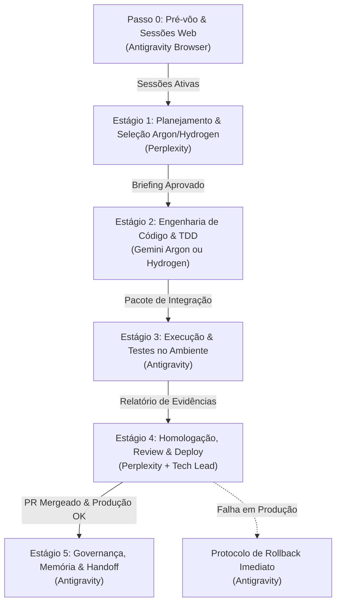

# Tríade — Framework Multi-Agente de Alta Precisão (`/triade`, `/tri`)

> "Perplexity planeja e homologa; Gemini Argon/Hydrogen modelam e codificam; Antigravity executa, testa e integra; Tech Lead valida e decide."

---

## 🎯 1. Gatilhos de Ativação & Slash Commands

Você pode ativar esta skill a qualquer momento digitando:
- `/triade` ou `/tri`
- *"Iniciar fluxo tríade"*
- *"Orquestrar com Perplexity e Argon"*
- *"Executar ciclo tríade"*
- *"Planejar e implementar com a tríade"*

---

## 🎛️ 2. Modos de Operação (Full Tríade vs Bypass Direto)

Nem todo projeto ou tarefa exige a mobilização das 3 IAs. A skill suporta dois modos operacionais configuráveis via `.triad/config.json` ou comando no prompt:

```json
{
  "enabled": true,
  "mode": "full",
  "default_generator": "argon",
  "auto_preflight_browser": true
}
```

### A. Modo Tríade Completo (`mode: "full"`) — `/triade`
- **Indicação:** Novas funcionalidades críticas, regras de negócio complexas, modelos estatísticos/matemáticos, mudanças estruturais de schema e integrações de API.
- **Fluxo:** Perplexity ➔ Gemini Argon/Hydrogen ➔ Antigravity ➔ Homologação ➔ Deploy.

### B. Modo Bypass / Direto (`mode: "bypass"`) — `/tri bypass`
- **Indicação:** Tarefas do dia a dia, correções de bugs pontuais, documentação, refatorações menores ou scripts rápidos.
- **Fluxo:** O Antigravity executa a tarefa diretamente no ambiente, sem abrir abas do navegador nem acionar Perplexity/Argon, mantendo apenas os Quality Gates locais de teste e build.

---

## 🚦 3. Passo Zero: Pré-vôo no Navegador & Login Interativo

No modo `full`, o Antigravity executa a verificação web via subagente `browser`:
1. Acessa `https://www.perplexity.ai` e `https://gemini.google.com`.
2. Se houver login pendente ou CAPTCHA: **pausa a esteira e solicita que o Tech Lead faça login com usuário e senha**.
3. Com as sessões ativas, a orquestração segue automaticamente.

---

## ⚖️ 4. Critério de Seleção: Gemini Argon vs Gemini Hydrogen

| Critério | Gemini Argon (Raciocínio Pesado) | Gemini Hydrogen (Agilidade & Cirurgia) |
| :--- | :--- | :--- |
| **Complexidade** | Alta (algoritmos matemáticos, Dixon-Coles, endpoints novos). | Baixa/Média (campos extras, ajustes em React/Tailwind). |
| **Suíte de Testes** | Criação de suítes TDD completas do zero (10+ testes). | Adição de 1 a 3 casos de teste pontuais. |
| **Arquitetura** | Novos microsserviços, blueprints e esquemas relacionais. | Refatoração cosmética, textos, documentação e UI fixes. |

---

## 🔄 5. O Ciclo de Vida em 5 Estágios



1. **Estágio 1 — Planejamento & Arquitetura (Perplexity):** Emite o Briefing (`templates/perplexity-to-argon.md`).
2. **Estágio 2 — Engenharia de Código & TDD (Gemini Argon ou Hydrogen):** Gera o código e testes no Pacote de Integração (`templates/argon-to-antigravity.md`).
3. **Estágio 3 — Execução e Testes no Ambiente (Antigravity):** Aplica código, roda testes e gera o Relatório de Evidências (`templates/antigravity-to-perplexity.md`).
4. **Estágio 4 — Homologação, Review e Deploy (Perplexity + Tech Lead):** Audita evidências, faz merge do PR e valida produção. Dispara rollback se falhar.
5. **Estágio 5 — Governança e Memória Entre Projetos (Antigravity):** Registra ADR em `.memory/decisions.md` e sincroniza lições em `~/.gemini/config/skills/`.

---

## 🛡️ 6. Protocolo de Rollback Automatizado
Se o deploy falhar ou o `/api/health` retornar erro em produção:
```bash
git revert HEAD --no-edit
git push origin main
```
Notifica imediatamente com a causa-raiz identificada.
