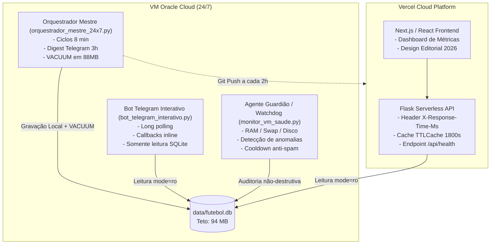

# Quadro Oficial de SLOs e SLIs - FutStats (2026)

> Framework de Engenharia de Confiabilidade (SRE) e Governança de Observabilidade para a arquitetura híbrida Vercel (Serverless) + Oracle Cloud (VM 24/7).

---

## 1. Visão Geral da Arquitetura e Escopo

O FutStats opera em um modelo híbrido distribuído:
- **Camada de Apresentação & API**: Next.js/React + Flask Serverless hospedados na Vercel (`https://scrapper-br.vercel.app`).
- **Camada de Engenharia & Mineração**: Oracle Cloud Infrastructure (VM Ampere A1 24/7) executando o orquestrador de mineração histórica (1902-2026), cálculo preditivo Dixon-Coles, precificação de odds e bot interativo no Telegram.
- **Camada de Armazenamento**: SQLite embarcado (`data/futebol.db`) versionado via Git com controle estrito de teto serverless (<94 MB).

---

## 2. Indicadores e Objetivos de Nível de Serviço (SLIs & SLOs)

| ID | Domínio | Indicador de Nível de Serviço (SLI) | Objetivo (SLO) | Janela de Medição | Error Budget | Ação de Mitigação |
|:---|:---|:---|:---|:---|:---|:---|
| **SLI-01** | **Disponibilidade da API Vercel** | $\frac{\text{Reqs } (2xx + 3xx + 4xx)}{\text{Total de Requisições}} \times 100$ | **$\ge$ 99.50%** | Janela rolante de 30 dias | 0.50% (~3h 36m downtime/mês) | Rotação de cache, rollback automático via Git, isolamento de fallbacks em modo degradação elegante. |
| **SLI-02** | **Latência de Consulta da API** | Percentil 95 ($p_{95}$) do tempo de resposta via header `X-Response-Time-Ms` nos endpoints `/api/*` | **$p_{95} < 200\text{ ms}$** | Janela de 7 dias | $\le 5\%$ das requisições $> 200\text{ ms}$ | Cache TTLCache (1800s) em memória, indexação SQLite B-Tree e lazy loading de confrontos históricos. |
| **SLI-03** | **Taxa de Sucesso de Mineração (VM)** | $\frac{\text{Blocos de raspagem e análise com código } 0}{\text{Total de blocos executados}} \times 100$ | **$\ge$ 99.00%** | Janela rolante de 24 horas | 1.00% ($\le 1$ falha por 100 blocos) | Backoff exponencial com jitter, timeout por processo (400s) e rotação de blocos históricos resilientes. |
| **SLI-04** | **Governança de Alertas Telegram** | Frequência de mensagens não-solicitadas e pontualidade do resumo operacional | **1 digest a cada 3h** (Alertas imediatos **apenas** sob quebra de SLO) | Contínua (ciclos de 3h) | 0 mensagens fora do digest sem incidente crítico | Silêncio inteligente ativo; alertas imediatos limitados a quedas de processos, corrupção ou violação de SLO. |
| **SLI-05** | **Teto de Armazenamento Serverless** | Tamanho do arquivo compactado/ativo `data/futebol.db` | **$\le 94.0\text{ MB}$** (Gatilho preventivo em $88.0\text{ MB}$) | Contínua (por ciclo) | 0% acima de 94 MB | Execução automática de `VACUUM`, compressão gzip de backups e exclusão de tabelas temporárias. |

---

## 3. Detalhamento Técnico dos SLIs

### 3.1. SLI-01: Disponibilidade da API Vercel
- **Fórmula**:
  $$\text{SLI}_{\text{disp}} = \frac{\sum \text{Reqs}_{\text{ok}}}{\sum \text{Reqs}_{\text{total}}} \times 100$$
- **Healthcheck Primário**: Endpoint `/api/health` inspeciona a conectividade com `data/futebol.db`, tempo de consulta a `SELECT count(*) FROM partidas` e responde código HTTP 200 (ou 503 quando degradado).
- **Tratamento de Exceções**: Erros de cliente (400, 401, 404, 429) **não** consomem o Error Budget do serviço. Apenas erros internos (500, 502, 503, 504) são computados contra a disponibilidade.

### 3.2. SLI-02: Latência de Consulta p95 (< 200ms)
- **Implementação**: Middleware Flask injeta o cabeçalho `X-Response-Time-Ms` com medição via `time.perf_counter()`.
- **Estratégia de Cache**: `TTLCache(default_ttl=1800)` absorve consultas repetidas para tabelas de classificação, estatísticas de campeonatos e matrizes do modelo Dixon-Coles, garantindo latências inferiores a 15ms no cache hit.
- **Conexões SQLite**: Leitura isolada em URI `file:data/futebol.db?mode=ro` com PRAGMAs:
  - `PRAGMA query_only = ON;`
  - `PRAGMA synchronous = NORMAL;`
  - `PRAGMA cache_size = -64000;` (64 MB de cache em memória para SQLite)

### 3.3. SLI-03: Sucesso de Scraping 24x7 (>= 99.0%)
- **Mecanismo de Isolamento**: Cada script de raspagem (`scraper_ogol_brasileirao.py`, `scraper_ogol_estaduais.py`, etc.) roda isolado em processo filho via `subprocess.run(timeout=400)`. Falhas de rede, bloqueios Cloudflare ou timeouts capturados não derrubam o daemon mestre.
- **Rastreamento de Error Budget**:
  - O orquestrador rastreia o acumulado de `tarefas_sucesso` vs `tarefas_falha`.
  - Se a taxa na janela de 3 horas for menor que 99.0%, um alerta de degradação é incluído com prioridade.

### 3.4. SLI-04: Política Anti-Spam e Silêncio Inteligente no Telegram
- **Regime Normal**: Emissão exclusiva de **1 Digest Consolidado a cada 3 horas** (10.800 segundos), informando:
  - Número de ciclos concluídos.
  - Blocos históricos varridos.
  - Total de partidas e gols catalogados.
  - Tamanho exato do SQLite e margem restante para o teto de 94 MB.
  - Status de integridade e estabilidade da VM Oracle.
- **Regime de Emergência (Violação de SLO)**: Emissão imediata permitida apenas se:
  1. O daemon `orquestrador_mestre_24x7.py` ou `bot_telegram_interativo.py` parar inesperadamente.
  2. `futebol.db` ultrapassar 94.0 MB.
  3. `PRAGMA integrity_check` falhar (suspeita de corrupção).
  4. RAM disponível na VM ficar abaixo de 100 MB ou Disco livre abaixo de 1.0 GB.
- **Cooldown Anti-Tempestade**:
  - Alertas críticos: Cooldown de 5 minutos (máximo 1 alerta a cada 300s).
  - Alertas médios/preventivos: Cooldown de 15 minutos (máximo 1 alerta a cada 900s).

---

## 4. Política de Error Budget (Error Budget Policy)

Quando o orçamento de erro é consumido:

| Consumo do Error Budget | Classificação | Medidas Imediatas |
|:---|:---|:---|
| **0% a 49%** | 🟢 **Operação Saudável** | Desenvolvimento de features analíticas e mineração histórica em velocidade máxima. |
| **50% a 79%** | 🟡 **Atenção** | Investigação de queries com latência $> 150\text{ ms}$, auditoria de índices SQLite e revisão de timeouts de scraping. |
| **80% a 99%** | 🟠 **Risco Elevado** | Priorização mandatória de correções de estabilidade; redução do volume de novas raspagens em favor de desambiguação e `VACUUM`. |
| **$\ge$ 100% (Esgotado)** | 🔴 **Congelamento (Freeze)** | **Feature Freeze**: Bloqueio de novas adições estruturais; foco exclusivo em otimização do banco, purga de dados duplicados e elevação da taxa de disponibilidade. |

---

## 5. Matriz de Isolamento de Processos na VM



---

## 6. Procedimento de Validação Contínua dos SLOs

1. **Teste do Healthcheck**:
   ```bash
   curl -i https://scrapper-br.vercel.app/api/health
   # Deve retornar HTTP 200, status: ok, e latência de consulta < 200ms
   ```

2. **Verificação de Isolamento e Processos na VM**:
   ```bash
   ps aux | grep -E "orquestrador_mestre|bot_telegram|monitor_vm"
   ```

3. **Verificação do Teto Vercel**:
   ```bash
   ls -lh data/futebol.db
   # Deve ser < 94.0 MB estritamente
   ```
