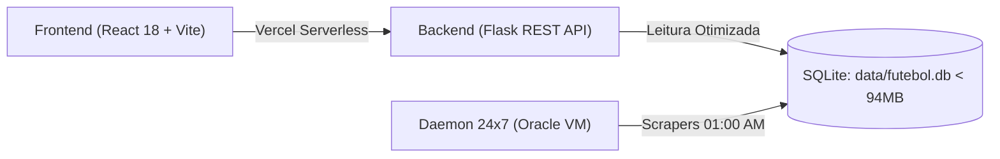

# FutStats — Contexto de Engenharia & Arquitetura para Consultoria Perplexity AI

> **Repositório GitHub**: [https://github.com/LeoBorba12/Scrapper-br](https://github.com/LeoBorba12/Scrapper-br)  
> **Deploy Vercel**: Dashboard Web em Produção  
> **Papel do Perplexity**: Consultor Técnico Sênior, Revisor Crítico de Arquitetura e Engenharia de Dados (Segunda Opinião Estratégica)

---

## 1. Visão Geral do Produto
O **FutStats** é uma plataforma analítica e preditiva independente de alta precisão dedicada ao futebol brasileiro (Série A, Copa do Brasil, Libertadores, Estaduais e acervo histórico desde 1902).

A plataforma combina:
1. **Acervo Histórico Relacional**: 115.753 partidas oficiais auditadas, 721 atletas com 46 métricas do OGol/Opta, 20 clubes com scouts completos e 135 técnicos catalogados.
2. **Modelagem Matemática Preditiva**: Modelo bivariado de Dixon-Coles calibrado com amortecimento temporal ($\tau$), correção de baixos placares ($\rho$), geração de xG (Expected Goals), xGOT e probabilidades normalizadas de odds 1X2.
3. **Réplicas 3D Procedurais Interativas**: Sala de Troféus com renderização física PBR (Three.js WebGL) das taças oficiais do futebol brasileiro com iluminação de estúdio HDRI e rotação orbital 360°.
4. **Dossiês Editoriais**: Perfil estilo OGol/Transfermarkt para clubes, página profunda do atleta (*ProtagonistaAtleta*) com mapas espaciais e radar de atributos, e scout de árbitros com rigor disciplinar.

---

## 2. Stack Tecnológica & Restrições Inegociáveis



### A. Frontend
- **Framework**: React 18 com Vite 5.
- **Visualização 3D**: Three.js (`^0.182.0`) com `MeshPhysicalMaterial`, `ACESFilmicToneMapping` e ambientes HDR procedurais em canvas.
- **Gráficos & Mapas**: Recharts, canvas 2D nativo para radares PES pentagonais e mapas de calor de arremate.
- **Design System Editorial 2026 (Sem Tailwind)**:
  - Paleta Areia (Light `#F1E8DE`) e Carvão Quente (Dark `#1B1A17`).
  - Destaques em Oliva (`#5A673E` / `#B5BE93`) e Terracota (`#85573B`).
  - Conformidade estrita com **WCAG 2.2 AA** (contraste mínimo de 4.5:1 para texto e 3:1 para UI).
  - Inline styles com variáveis do [`frontend/src/tokens.css`](frontend/src/tokens.css). Proibido classes genéricas de Tailwind não compiladas.

### B. Backend & Banco de Dados
- **API**: Flask modular (`backend/app.py`, `backend/rotas_expansao.py`) rodando sob Vercel Serverless Functions.
- **Banco de Dados**: SQLite embarcado em [`data/futebol.db`](data/futebol.db).
- **TETO RIGOROSO VERCEL**: O arquivo `data/futebol.db` deve permanecer **estritamente abaixo de 94.0 MB** (limite de bundle do serverless).
- **PRAGMA journal_mode**: Obrigatoriamente **`DELETE`**. Proibido o uso de `WAL` em produção para evitar criação de arquivos voláteis (`.db-wal` / `.db-shm`) que estouram o deployment.

### C. Qualidade & Regression Gates
- **Model Evals**: Suíte `pytest tests/test_model_evals.py` (22/22 testes obrigatórios após qualquer alteração matemática).
- **Auditor de Integridade**: `python scripts/auditar_integridade_dados.py` (12 regras de integridade relacional).
- **Validação Completa**: `python scripts/executar_validacoes_completas_futstats.py`.

---

## 3. Estrutura do Repositório

```text
/
├── backend/
│   ├── app.py                     # Entrypoint Flask e orquestração de rotas
│   └── rotas_expansao.py          # Endpoints de clubes, atletas, árbitros e 3D
├── data/
│   └── futebol.db                 # Base SQLite relacional (90.15 MB, journal_mode: delete)
├── frontend/
│   ├── src/
│   │   ├── components/
│   │   │   ├── ClubProfileView.jsx     # Dossiê completo do clube (Estilo OGol)
│   │   │   ├── EditorialClubes.jsx     # Aba de clubes com busca e autosuggest
│   │   │   ├── ProtagonistaAtleta.jsx  # Dossiê individual e carreira do jogador
│   │   │   ├── TrophyGallery3D.jsx     # Sala de Troféus com visualizador 3D
│   │   │   └── trophies/
│   │   │       └── trophyBuilders.js   # 7 construtores procedurais de taças em Three.js
│   │   ├── tokens.css             # Design tokens oficiais WCAG 2.2 AA
│   │   └── App.jsx                # Orquestrador de abas e estado da aplicação
├── scripts/
│   ├── auditar_integridade_dados.py            # Validador de 12 regras relacionais
│   ├── executar_validacoes_completas_futstats.py # Suíte unificada de testes e design
│   ├── orquestrador_mestre_24x7.py             # Daemon com agendamento diário (01:00 AM)
│   └── scraper_ogol_estatisticas_completas.py  # Pipeline de scraping e enriquecimento
└── tests/
    └── test_model_evals.py        # Suíte de 22 testes de Dixon-Coles e integridade
```

---

## 4. Onde a Ajuda do Perplexity é Valiosa
Quando consultado, esperamos que o Perplexity atue fornecendo:
1. **Segunda Opinião Arquitetural**: Desafiar premissas de UX, dados ou queries SQL, sugerindo abordagens mais elegantes e econômicas.
2. **Benchmark com Líderes Globais**: Comparar nossas métricas e modelos visuais com plataformas como Opta, FBref, SofaScore, FotMob e Transfermarkt.
3. **Novas Soluções de Scraping e Resiliência**: Boas práticas contra bloqueios, tratamento de dados faltantes e algoritmos de deduplicação sem inflar o SQLite.
4. **Otimizações Matemáticas e Modelagem**: Calibração avançada de Dixon-Coles, xG com decaimento exponencial, cálculo dinâmico de valor de mercado e ratings estatísticos por posição.
5. **Revisão Cirúrgica de Código**: Identificar gargalos de renderização no React/Three.js ou desperdício de memória antes da implementação.
