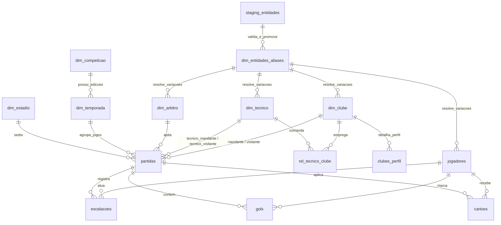

# Modelo Canônico de Dados do FutStats (Desafio 24)

**Versão:** 1.0 (Canônica)  
**Status do Banco:** 83,71 MB (Folga para teto Vercel: 10,29 MB | Abaixo do soft limit de 84,0 MB)  
**Teto Operacional:** SQLite em modo `DELETE` (`PRAGMA journal_mode = DELETE`)  
**Acervo Coberto:** 115.753 partidas (1902–2026), 117.580 gols, 2.462 clubes, 3.946 atletas, 324 técnicos e 278 árbitros.

---

## 1. Diagrama Entidade-Relacionamento Canônico (ERD)



---

## 2. Dicionário de Dados Canônico

### 2.1. `dim_clube` (Dimensão Clube Canônica)
Representa a autoridade institucional de cada agremiação registrada no acervo.
- `clube_id` (INTEGER, PK AUTOINCREMENT): Identificador canônico imutável.
- `nome` (TEXT, NOT NULL UNIQUE): Nome de exibição padronizado (ex: "Palmeiras", "Flamengo").
- `nome_oficial` (TEXT): Razão social ou denominação oficial (ex: "Sociedade Esportiva Palmeiras").
- `sigla` (TEXT): Tríade oficial ou sigla clássica (ex: "PAL", "FLA").
- `estado` (TEXT): Unidade federativa de origem (ex: "SP", "RJ", "RS").
- `pais` (TEXT, DEFAULT 'Brasil'): Nacionalidade da agremiação.
- `fundacao` (TEXT): Data de fundação no formato ISO YYYY-MM-DD.
- `fonte_id_externa` (TEXT): ID de referência cruzada (ex: CBF, RSSSF, OGol).

### 2.2. `dim_competicao` (Dimensão Competição)
- `competicao_id` (INTEGER, PK AUTOINCREMENT): Identificador canônico da competição.
- `nome` (TEXT, NOT NULL UNIQUE): Nome da competição (ex: "Campeonato Brasileiro Série A").
- `tipo` (TEXT): Categoria ('Nacional', 'Estadual', 'Continental', 'Copa Nacional').
- `pais` (TEXT, DEFAULT 'Brasil'): País sede da competição.
- `confederacao` (TEXT, DEFAULT 'CBF'): Órgão regulador ('CBF', 'CONMEBOL', 'FIFA').

### 2.3. `dim_temporada` (Dimensão Temporada / Edição)
- `temporada_id` (INTEGER, PK AUTOINCREMENT): Identificador da edição da competição.
- `competicao_id` (INTEGER, NOT NULL, FK `dim_competicao`): Competição vinculada.
- `edicao` (TEXT, NOT NULL): Ano ou rótulo da edição (ex: "2024", "1999").
- `ano_inicio` (INTEGER, NOT NULL): Ano de início da disputa.
- `ano_fim` (INTEGER): Ano de término da disputa.
- `formato` (TEXT): Formato de disputa ('Pontos Corridos', 'Mata-Mata', 'Misto').

### 2.4. `dim_tecnico` (Dimensão Técnico Canônica)
- `tecnico_id` (INTEGER, PK AUTOINCREMENT): Identificador canônico do treinador.
- `nome_exibicao` (TEXT, NOT NULL UNIQUE): Nome canônico de bancada (ex: "Abel Ferreira", "Telê Santana").
- `pais` (TEXT, DEFAULT 'Brasil'): País de nacionalidade.
- `data_nascimento` (TEXT): Data de nascimento (ISO YYYY-MM-DD).
- `fonte_id_externa` (TEXT): ID de referência em fontes externas.

### 2.5. `dim_arbitro` (Dimensão Árbitro Canônica)
- `arbitro_id` (INTEGER, PK AUTOINCREMENT): Identificador canônico do árbitro.
- `nome_exibicao` (TEXT, NOT NULL UNIQUE): Nome completo/canônico (ex: "Wilton Pereira Sampaio").
- `pais` (TEXT, DEFAULT 'Brasil'): País de atuação.
- `data_nascimento` (TEXT): Data de nascimento.
- `fonte_id_externa` (TEXT): Registro federativo/CBF.

### 2.6. `dim_estadio` (Dimensão Estádio Canônica)
- `estadio_id` (INTEGER, PK AUTOINCREMENT): Identificador canônico da praça esportiva.
- `nome` (TEXT, NOT NULL UNIQUE): Nome do estádio (ex: "Allianz Parque", "Maracanã").
- `cidade` (TEXT): Município onde está situado.
- `estado` (TEXT): Unidade federativa.
- `capacidade` (INTEGER): Lotação máxima oficial.

### 2.7. `rel_tecnico_clube` (Fato Relacional de Passagens de Técnicos)
- `tecnico_id` (INTEGER, FK `dim_tecnico`): Treinador.
- `clube_id` (INTEGER, FK `dim_clube`): Clube comandado.
- `data_inicio` (TEXT): Data do primeiro jogo no ciclo.
- `data_fim` (TEXT): Data do último jogo registrado.
- `partida_id_inicio` (INTEGER): ID da partida de estreia.
- `partida_id_fim` (INTEGER): ID da última partida registrada.
- `total_jogos` (INTEGER): Total de jogos no ciclo apurado.
- *PK Composta:* `(tecnico_id, clube_id, data_inicio)`.

### 2.8. `dim_entidades_aliases` (Resolução Canônica de Identidade)
Garante a unificação de grafias, apelidos históricos e abreviações em uma única identidade canônica.
- `alias_id` (INTEGER, PK AUTOINCREMENT): Identificador do alias.
- `tipo_entidade` (TEXT, NOT NULL): Tipo ('clube', 'atleta', 'tecnico', 'arbitro', 'estadio', 'competicao').
- `entidade_id` (INTEGER, NOT NULL): ID canônico na tabela de dimensão correspondente.
- `alias_nome` (TEXT, NOT NULL COLLATE NOCASE): Variação textual (ex: "SEP", "Palmeiras", "Verdão").
- `fonte` (TEXT, NOT NULL): Fonte do alias ('canonica', 'ogol', 'cbf', 'sofascore', 'manual').
- `confianca` (REAL, DEFAULT 1.0): Nível de confiança da resolução (0.0 a 1.0).
- `criado_em` (TEXT, DEFAULT CURRENT_TIMESTAMP): Timestamp de auditoria.
- *Constraint Única:* `UNIQUE(tipo_entidade, alias_nome)`.

### 2.9. `staging_entidades` (Staging de Ingestão e Quarentena de Scrapers)
- `staging_id` (INTEGER, PK AUTOINCREMENT): ID da carga bruta.
- `fonte` (TEXT, NOT NULL): Identificador da fonte ('ogol', 'cbf', 'sofascore', 'rsssf').
- `entidade_tipo` (TEXT, NOT NULL): Tipo da entidade.
- `id_externo` (TEXT): ID na base de origem.
- `nome_bruto` (TEXT, NOT NULL): Nome bruto coletado pelo crawler.
- `payload_json` (TEXT, NOT NULL): Carga JSON íntegra serializada.
- `completude` (REAL, DEFAULT 1.0): Métrica calculada de preenchimento de campos obrigatórios.
- `confianca` (TEXT, DEFAULT 'alta'): Avaliação ('alta', 'media', 'baixa').
- `status_resolucao` (TEXT, DEFAULT 'pendente'): 'pendente', 'aprovado', 'quarentena', 'conflito'.
- `motivo_quarentena` (TEXT): Descrição textual caso reprovado no gate.
- `hash_payload` (TEXT, NOT NULL): SHA-256 do payload para idempotência e proteção contra duplicação.
- `criado_em` (TEXT, DEFAULT CURRENT_TIMESTAMP).

---

## 3. Contrato de Scraper e Ciclo de Vida da Carga

```
[Scraper Externo]
       │
       ▼ (Payload JSON)
[Validação Estrutural: campos obrigatórios + completude >= 0.50]
       │
       ├─ Reprovado ──► [staging_entidades (status = 'quarentena')]
       │
       ▼ Aprovado
[Resolução de Identidade: dim_entidades_aliases]
       │
       ├─ Conflito (múltiplos IDs) ──► [staging_entidades (status = 'conflito')]
       │
       ▼ Resolvido ou Novo
[staging_entidades (status = 'aprovado')] ──► [Promoção p/ Dimensões Canônicas + Registro de Novos Aliases]
```

### Regras de Ouro do Pipeline
1. **Idempotência por Hash:** Todo payload gera um hash SHA-256 determinístico. Cargas idênticas são ignoradas.
2. **Zero Contaminação Direta:** Nenhum scraper grava diretamente nas tabelas `dim_*` ou `partidas`. Toda linha passa por staging.
3. **Quarentena Automática:** Se um atleta for coletado sem clube atual ou posição, ou se aliases colidirem com entidades distintas, o registro é congelado em quarentena com `motivo_quarentena`.
4. **Versionamento de Aliases:** Quando uma entidade é promovida, suas variações nominais são versionadas em `dim_entidades_aliases` com grau de confiança (ex: 0.95 para OGol, 0.90 para apelidos).
