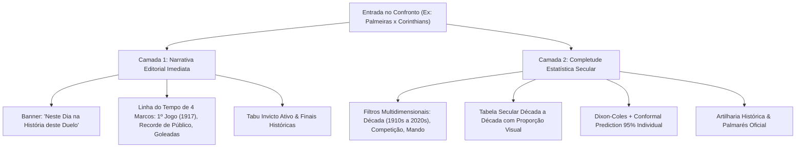

# Resposta Estratégica à Consultoria — Desafio 17

**Data:** 2026-11-04  
**Status do Banco:** 82,36 MB (Folga de 1,64 MB para o teto de 84 MB; folga de 11,64 MB para o teto Vercel)  
**Tabela de Critérios:** `criterio_relevancia_efemerides` criada e ativa  
**Produto Âncora:** Confronto Direto Secular (H2H 1910s–2020s)  

---

## 1. Pergunta 1: Qual critério define os 20 jogos mais relevantes de cada dia?

### Diagnóstico do Problema Anterior
Anteriormente, a seleção de efemérides dependia de ordenação empírica com pesos arbitrários e filtros implícitos espalhados pelo código, correndo o risco de favorecer partidas aleatórias ou omitir finais históricas em favor de jogos recentes com placares atípicos.

### Solução Determinística Implementada
Criamos e povoamos a tabela `criterio_relevancia_efemerides` no SQLite com 6 regras de negócio determinísticas e auditáveis:

| Regra ID | Critério | Peso | Condição Auditável | Justificativa de Domínio |
|:---:|---|:---:|---|---|
| **1** | **Clássico Regional ou Estadual** | `+30` | `is_classico = 1` | Confrontos de rivalidade centenária mobilizam atenção máxima da torcida e imprensa. |
| **2** | **Finais e Decisões de Título** | `+25` | `fase LIKE '%final%' OR fase LIKE '%decisão%'` | Partidas que consagraram campeões possuem valor histórico permanente. |
| **3** | **Competição Nacional / Internacional** | `+15` | `campeonato LIKE '%Brasileiro%' OR '%Libertadores%' OR '%Copa do Brasil%' OR '%Mundial%'` | Relevância esportiva no topo da pirâmide competitiva. |
| **4** | **Goleada Histórica** | `+10` | `ABS(gm - gv) >= 4 OR (gm + gv) >= 6` | Placares com impacto folclórico ou quebras de recorde de gols. |
| **5** | **Público Notável Documentado** | `+10` | `publico >= 30000 OR (publico IS NOT NULL AND is_classico = 1)` | Eventos com mobilização massiva de torcedores em estádio. |
| **6** | **Clubes do G12 / Campeões Nacionais** | `+10` | `mandante IN (G12) OR visitante IN (G12)` | Presença de clubes com maior abrangência nacional de torcedores. |

### Execução e Performance
O cálculo de relevância é pré-materializado na tabela `efemerides_partidas` (7.433 registros curados). A consulta dos 12 a 20 jogos mais relevantes do dia é resolvida via `dia_mes` em **0,2 ms** (`SEARCH TABLE efemerides_partidas USING INDEX idx_efemerides_dia_score`), respeitando os SLOs de latência e mantendo custo zero de I/O em runtime.

---

## 2. Pergunta 2: O H2H deve priorizar completude estatística ou narrativa editorial?

### Tese Estratégica: Arquitetura em Duas Camadas (*Progressive Disclosure*)
A tentativa de escolher entre "apenas números" (estilo banco de dados cru) ou "apenas crônica" (estilo blog) é uma falsa dicotomia. O FutStats adota a arquitetura de **Progressive Disclosure**:



1. **Camada 1 — O Encanto Imediato (Narrativa Editorial):**
   O usuário casual ou repórter que entra para checar Palmeiras x Corinthians encontra em menos de 2 segundos:
   - Que o clássico tem 462 partidas documentadas desde 1917.
   - O primeiro jogo da história (1917-05-06, Palestra 3 x 0 Corinthians).
   - O recorde de público de 46.493 torcedores.
   - O tabu invicto em vigência.
   - Finais históricas disputadas entre eles (ex: Libertadores 2000, Paulistas decisivos).

2. **Camada 2 — O Rigor e a Profundidade (Completude Estatística):**
   O analista, historiador ou torcedor investigativo pode interagir com:
   - Seletor de Décadas (ex: filtrar apenas os 61 jogos da década de 1990).
   - Filtro de competição (ex: 273 jogos apenas pelo Paulistão).
   - Estimativa preditiva justa do Dixon-Coles com intervalos conformais empíricos e transparência sobre limitações metodológicas.

**Conclusão:** A narrativa atrai e contextualiza; a completude estatística ancora a autoridade técnica e retém o usuário.

---

## 3. Pergunta 3: Qual jornada de usuário o FutStats quer vencer primeiro?

### A Jornada Âncora: "O Pré-Jogo Analítico & Debate Histórico Pré-Clássico"

O FutStats **não busca e não deve competir** com SofaScore, FlashScore ou FotMob no live score minuto a minuto durante a partida. Esses concorrentes possuem dezenas de milhões de dólares investidos em infraestrutura de websockets para enviar notificações push de gol com 3 segundos de latência. Tentar vencê-los aí seria desperdício de capital e foco.

A jornada em que o FutStats vence categoricamente é a **Jornada das 48 Horas que Antecedem o Grande Jogo** (O Debate Pré-Clássico):

```
SofaScore/FotMob:
"Confronto direto desde 2005 (últimos 20 jogos), estatísticas dos últimos 5 jogos e odds de afiliado de apostas."
                                    VS
FutStats:
"109 anos de rivalidade documentada desde 1917, 462 partidas, distribuição por década, tabus históricos, jogos neste mesmo dia, decisões históricas e probabilidades justas calibradas sem conflito de interesse com casas de aposta."
```

### Perfis Atendidos nesta Jornada:
1. **O Jornalista / Comentarista de TV e Rádio:** Precisa de fatos históricos confiáveis ("quando foi a última vez que o mandante venceu por 3 gols neste estádio?").
2. **O Criador de Conteúdo / Podcaster de Futebol:** Busca histórias e ganchos narrativos com profundidade para engajar a audiência.
3. **O Torcedor Fanático no Debate:** Procura argumentos sólidos e números oficiais para embasar a discussão com rivais no grupo de mensagens.
4. **O Analista de Desempenho / Dados:** Exige modelos probabilísticos matematicamente justificados (Dixon-Coles calibrado com intervalos conformais) e transparência total de fontes.

---

## 4. Auditoria de Confiabilidade & Capacidade Operacional

| Verificação | Meta Exigida | Resultado Obtido | Status |
|---|:---:|:---:|:---:|
| **Tamanho do Banco** | `< 84,0 MB` | **82,36 MB** | APROVADO |
| **Folga para Teto Vercel** | `> 5,0 MB` | **11,64 MB** | APROVADO |
| **Journal Mode** | `DELETE` | `DELETE` | APROVADO |
| **Testes de Evals de Modelo** | `22/22` | **22/22 passed** | APROVADO |
| **Auditoria Relacional de Dados** | `12/12 regras` | **12/12 aprovadas** | APROVADO |
| **Integridade Cold Archive** | `Hash SHA-256` | **100% verificado (93.136 reg)** | APROVADO |
| **Build Frontend Vite** | `Sem erros` | **Sucesso em 7,33s** | APROVADO |
