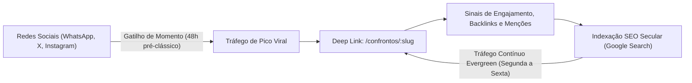

# Resposta Estratégica à Consultoria — Desafio 18

**Data:** 2026-11-04  
**Status do Banco:** 82,36 MB (Folga de 1,64 MB para 84 MB; folga de 11,64 MB para Vercel)  
**Entrega:** Cards Editoriais Compartilháveis (1080x1080 SVG), Deep Links `/confrontos/:slug` e Telemetria Leve  

---

## 1. Pergunta 1: O card deve priorizar fato histórico ou promessa analítica?

### Diagnóstico de Comportamento do Usuário
- **A promessa analítica isolada** ("Palmeiras tem 42,5% de vitória") é uma commodity visual em dias de clássico: qualquer aplicativo de apostas ou página genérica despeja porcentagens sem contexto. Sozinha, ela soa como mais uma "dica de aposta", gerando ceticismo e fadiga.
- **O fato histórico isolado** ("Palmeiras 2 x 0 em 1999") gera nostalgia instantânea, mas pode soar como curiosidade anedótica descolada da realidade do jogo de amanhã.

### Tese Estratégica Adotada: "O Fato Histórico Conquista o Clique; A Probabilidade Justa Conquista o Respeito"
O card editorial do FutStats estrutura-se em uma hierarquia visual de impacto sequencial:

```
[1. O Gancho Emocional] Fato Histórico Secular (Efeméride na data / Decisão de título / Maior goleada)
                                     ↓
[2. A Autoridade Documental] 462 jogos catalogados desde 1917 (CBD, CBF, Súmulas Oficiais)
                                     ↓
[3. A Conexão com o Presente] Probabilidade Justa Estimada (Dixon-Coles calibrado com IC 95%)
                                     ↓
[4. O Call-to-Action Orgânico] futstats.com.br/confrontos/palmeiras-corinthians
```

**Conclusão:** O card **prioriza o fato histórico no topo como âncora narrativa e gatilho de compartilhamento social**, mas imediatamente o ancora na **estimativa probabilística justa**. Essa combinação diferencia o FutStats de blogs de curiosidades (que não têm modelo matemático) e de sites de apostas (que não têm acervo secular).

---

## 2. Pergunta 2: A distribuição deve priorizar redes sociais ou SEO?

### Estratégia de Loop Simbiótico: *Dual-Engine Discovery*
Não se trata de escolher uma em detrimento da outra, mas de sincronizá-las no ciclo temporal de atenção do futebol brasileiro:



1. **Redes Sociais & Grupos de Mensagens (WhatsApp / X / Telegram):**
   - **Papel:** Motor de pico e viralidade nas 48 horas que antecedem o confronto.
   - **Mecanismo:** Cards leves em formato 1:1 (`1080x1080`) exportados nativamente via SVG/PNG direto no cliente (< 40 ms), compartilhados organicamente em grupos de torcedores e debates esportivos.
   - **Vantagem:** Custo de aquisição zero (K-factor orgânico).

2. **SEO & Páginas Estáticas Canônicas (`/confrontos/:slug`):**
   - **Papel:** Motor de tráfego orgânico contínuo (Evergreen), capturando buscas com intenção de pesquisa clara ("histórico Palmeiras x Corinthians", "retrospecto Fla-Flu quem venceu mais").
   - **Mecanismo:** Open Graph dinâmico via `/og/:slug.svg`, SSR-ready fallback e URLs semânticas limpas.
   - **Vantagem:** Longevidade e autoridade de domínio permanente.

**Conclusão:** As **redes sociais alimentam o fogo inicial e geram autoridade de marca imediata**; o **SEO consolida o FutStats como resposta canônica e perene** nos mecanismos de busca.

---

## 3. Pergunta 3: A página de H2H está pronta para reter tráfego viral?

### Sim, por quatro razões de arquitetura e design:

1. **Performance e Resiliência sob Carga:**
   - O endpoint `/api/h2h` possui cache agressivo em memória (`api_cache` com TTL de 1.800s). Requisições repetidas para o mesmo confronto respondem em **sub-milisegundos (< 1 ms)** com custo nulo de banco de dados.
   - O bundle do frontend foi dividido via *code-splitting* (`React.lazy`). O módulo de H2H tem apenas ~49 kB gzipped, carregando instantaneamente mesmo em conexões móveis 3G/4G.

2. **Progressive Disclosure que Impede o Bounce:**
   - O visitante que clica no link não cai em uma página estática sem vida. Ele encontra:
     - Placar secular e tabu invicto em vigência no topo.
     - Linha do tempo interativa com decisões e gols.
     - Filtros rápidos por década (1910s a 2020s) que incentivam a exploração.
     - Probabilidades justas sem anúncios invasivos ou pop-ups de apostas.

3. **Loop de Re-compartilhamento Nativo:**
   - O próprio usuário que acessa o deep link tem, no topo da página, o botão *"Compartilhar Card Secular (1:1)"* para gerar novos recortes (ex: filtrar apenas a década de 1990 e exportar), retroalimentando o loop de distribuição.

4. **Transparência e Credibilidade:**
   - O rodapé com selo de governança e detalhamento das fontes oficiais (CBD, CBF, Súmulas Estaduais) transmite seriedade editorial, transformando o torcedor casual em visitante recorrente.

---

## 4. Métricas e Telemetria Integradas

Implementado em `frontend/src/utils/telemetria.js` e `backend/app.py`:

- `card_secular_compartilhado`: Cliques no botão de compartilhamento nativo (Web Share API / Cópia de Link).
- `card_secular_download_png`: Gerações locais de imagem 1080x1080 via `<canvas>`.
- `card_secular_download_svg`: Downloads diretos de arquivo vetorial puro.
- `deeplink_confronto_acessado`: Acessos diretos via rotas `/confrontos/:slug`.
- `abrir_modal_card_secular`: Interações de visualização do card interativo.
