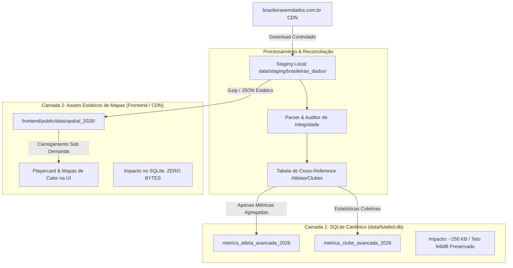

# Investigação Técnica: Brasileirão em Dados (brasileiraoemdados.com.br)

**Data da Auditoria:** 06 de Novembro de 2026  
**Investigador:** Antigravity / FutStats Intelligence  
**Alvo:** `https://brasileiraoemdados.com.br/`  
**Status do Alvo:** Ativo, servido via Cloudflare CDN (estático)  
**Escopo Analisado:** Temporada 2026 do Brasileirão Série A (338 partidas, 501.563 eventos)  

---

## 1. Veredito Executivo

### Classificação: **VIÁVEL COM RESTRIÇÕES (ALTO VALOR ANALÍTICO)**

```
┌──────────────────────────────────────────────────────────────────────────┐
│                             VEREDITO FINAL                              │
│                                                                          │
│  [VIÁVEL COM RESTRIÇÕES]                                                │
│  • Viabilidade de Acesso: EXCELENTE (CDN estática pública, sem WAF)     │
│  • Fidelidade Analítica:  EXCEPCIONAL (eventos espaciais x,y + 135 KPIs) │
│  • Risco de Capacidade:   CRÍTICO SE INGERIDO BRUTO NO SQLITE (Teto 94MB)│
│  • Risco de Dependência:  MÉDIO/ALTO (fonte de estudante / scrap FotMob) │
│  • Estratégia Recomendada: Ingestão de métricas agregadas no SQLite     │
│                           + preservação de mapas em assets estáticos     │
└──────────────────────────────────────────────────────────────────────────┘
```

### Justificativa Técnica

1. **Acessibilidade e Desempenho:** O site é uma Single Page Application (SPA) 100% estática hospedada em Cloudflare CDN. Toda a inteligência reside no frontend (D3.js + Vanilla JS) e os dados brutos são pré-processados e distribuídos em arquivos JSON estáticos compactados. Não há autenticação, não há tokens efêmeros, não há Cloudflare Turnstile/CAPTCHA e as respostas contêm cabeçalhos `Access-Control-Allow-Origin: *`.
2. **Qualidade dos Dados:** O acervo contém **501.563 eventos com coordenadas cartesianas normalizadas (x, y)**, 135 métricas avançadas por jogador (xG, xA, passes progressivos, field tilt, PPDA, ações que geram finalização) e logs partida a partida de 728 atletas em 338 jogos do Brasileirão 2026.
3. **Restrição Estrutural Inegociável (Teto Vercel):** O FutStats possui um teto oficial de 94,00 MB na Vercel, soft limit de 84,00 MB e meta saudável de 80,00 MB. O banco SQLite canônico está hoje em **79,28 MB** (folga de 4,72 MB). O volume total descompactado dos JSONs do site é de aproximadamente **88 MB**. **Ingerir eventos brutos no SQLite canônico destruiria imediatamente a governança de capacidade e bloquearia o deploy da Vercel.**
4. **Governança de Dados:** O site cobre exclusivamente a Série A 2026. Ele **não** possui histórico pré-2026, nem divisões de acesso, nem Copa do Brasil, nem dados de árbitros ou técnicos. Portanto, deve ser tratado estritamente como **fonte de enriquecimento da Série A 2026**, jamais competindo com a base histórica de 115.753 partidas do FutStats.

---

## 2. Mapa de Endpoints e Recursos

A infraestrutura do site não depende de um backend dinâmico (Node, Flask ou Go); ela funciona inteiramente como um repositório estático de alta performance servido pela Cloudflare.

| Endpoint | Método | Formato | Tamanho Médio | Descrição do Conteúdo |
|---|:---:|:---:|:---:|---|
| `/data/core.json` | `GET` | JSON | ~3,71 MB | Metadados da liga, 20 times com estatísticas de equipe, 728 jogadores consolidados e 338 partidas com mandante, visitante, placar e estádio. |
| `/data/teams/{team_id}.json` | `GET` | JSON | ~1,5 – 2,1 MB cada (Total: ~35 MB) | Eventos agregados da equipe no campeonato: passes, chutes, defesas, toques, conduções, chutes sofridos e escalações por jogo (`lu`). |
| `/data/pev/{team_id}.json` | `GET` | JSON | ~2,0 – 3,2 MB cada (Total: ~50 MB) | Eventos granulares por jogador daquele clube: tuplas de eventos (`ev`), toques espaciais (`tc`) e histórico partida a partida (`log`). |
| `/assets/crests/{team_id}.png` | `GET` | PNG | ~5 – 15 KB | Escudos oficiais estilizados dos 20 clubes participantes. |
| `https://images.fotmob.com/...` | `GET` | PNG | ~15 – 35 KB | Fotos oficiais dos jogadores mapeadas pelo ID do FotMob (`fm`). |

### Cabeçalhos de Resposta Observados (Cloudflare CDN)
```http
HTTP/2 200 OK
date: Fri, 06 Nov 2026 15:11:05 GMT
content-type: text/html; charset=utf-8 (para rotas) / application/json (para data)
access-control-allow-origin: *
cache-control: public, max-age=14400, must-revalidate
server: cloudflare
cf-cache-status: HIT
```

> [!NOTE]
> Rotas não encontradas ou `/robots.txt` retornam `200 OK` apontando para o `index.html` padrão da SPA (fallback padrão de roteamento client-side em Cloudflare Pages / Vercel). Não há diretivas restritivas explícitas em `robots.txt`.

---

## 3. Exemplos Reais de Payloads Coletados

### A. Metadados e Partidas (`/data/core.json`)
```json
{
  "meta": {
    "season": "2026",
    "league": "Brasileirão Série A",
    "n_matches": 338,
    "n_events": 501563,
    "xg_model": {
      "shots": 9501,
      "goals": 868,
      "xg": 866.9
    }
  },
  "matches": [
    {
      "id": 1955925,
      "d": "2026-01-28",
      "h": 1232,
      "a": 1244,
      "hs": 2,
      "as_": 1,
      "v": "Estadio do Maracanã"
    },
    {
      "id": 1956096,
      "d": "2026-11-06",
      "h": 1230,
      "a": 1221,
      "hs": 3,
      "as_": 2,
      "v": "Estadio Mineirão"
    }
  ]
}
```

### B. Atleta Consolidado com Estatísticas Avançadas (`/data/core.json`)
Exemplo: Atleta **Hulk** (`id: 16886`, FotMob `fm: 20276`):
```json
{
  "id": 16886,
  "name": "Hulk",
  "team": 1232,
  "teams": [1232, 1235],
  "pos": "ATA",
  "posg": "Atacante",
  "fm": 20276,
  "cc": "BRA",
  "pos_auto": "ATA",
  "s": {
    "goals": 16.0,
    "npgoals": 15.0,
    "pen_goals": 1.0,
    "pens_taken": 1.0,
    "assists": 9.0,
    "shots": 94.0,
    "np_shots": 93.0,
    "shots_on_target": 38.0,
    "xg": 10.42,
    "npxg": 9.66,
    "xa": 6.84,
    "passes": 842.0,
    "prog_passes": 78.0,
    "key_passes": 52.0,
    "big_chances_created": 14.0,
    "sca": 132.0,
    "gca": 18.0,
    "carries": 620.0,
    "prog_carries": 88.0,
    "takeons_won": 42.0,
    "minutes": 2480.0
  },
  "tm": {
    "goals": 36.0,
    "xg": 34.81,
    "passes": 14116.0
  }
}
```

### C. Escalação por Partida (`/data/teams/{team_id}.json -> lu`)
Exemplo: Minutagem exata e condição de titular/reserva na partida de índice 154:
```json
"lu": {
  "154": [
    [88300, 0, 91, 1],    // [atleta_id, min_entrada, min_saida, is_titular]
    [279575, 58, 96, 0],  // Reserva: entrou aos 58', jogo acabou aos 96'
    [297581, 92, 96, 0]   // Reserva: entrou aos 92'
  ]
}
```

### D. Evento Espacial Normalizado (`/data/pev/{team_id}.json -> ev`)
Tupla compactada de 11 posições decodificada diretamente a partir do motor `mapview.js`:
```json
[
  0,       // [0] code: 0=passe, 1=condução, 2=finalização, 3=drible, 4=desarme, 5=interceptação, 6=corte, 7=recuperação
  39.6,    // [1] x: coordenada inicial (0 a 100)
  37.3,    // [2] y: coordenada inicial (0 a 100)
  53.3,    // [3] ex: coordenada final x (ou boca do gol y se finalização)
  42.3,    // [4] ey: coordenada final y (ou boca do gol z se finalização)
  1,       // [5] ok: 1=sucesso, 0=incompleto/falha
  185,     // [6] matchIdx: índice da partida no campeonato
  42,      // [7] minute: minuto do lance
  4,       // [8] flags: máscara de bits (ex: &4 = progressivo, &1 = decisivo, &8 = cruzamento)
  0.085,   // [9] extra: xG da finalização ou passador do passe recebido
  279575   // [10] pid: ID do jogador
]
```

---

## 4. Inventário Completo de Campos e Métricas

### A. Dimensão Partida (`matches`)
- `id`: Identificador original da partida (compatível com a chave canônica da API FotMob).
- `d`: Data do confronto (`YYYY-MM-DD`).
- `h` e `a`: IDs do clube mandante e visitante no sistema interno.
- `hs` e `as_`: Gols marcados pelo mandante e pelo visitante.
- `v`: Nome do estádio (venue).

### B. Dimensão Clube (`teams`)
- Identificadores: `id`, `name`, `short` (sigla), `fm` (ID do FotMob para escudos e logos).
- Desempenho e Classificação: `mp` (jogos), `w`, `d`, `l`, `gf`, `ga`, `gd`, `pts`, `rank`, `form` (últimos 5 jogos).
- Métricas Avançadas Coletivas:
  - Posse de bola (`possession`), Field Tilt (`field_tilt`), PPDA (`ppda` - pressão pós-perda na saída rival).
  - Altura da linha defensiva (`def_height`).
  - Expectativa de Gols pró e contra: `xg`, `npxg`, `xg_against`, `npxg_against`, `xpts` (pontos esperados).
  - Volumes de passe por terço de campo (`passes_def_third`, `passes_mid_third`, `passes_final_third`, `passes_into_box`).

### C. Dimensão Atleta (`players`)
- Identificadores e Perfil: `id`, `name`, `team` (clube atual), `teams` (todos os clubes da temporada), `pos` (GOL, ZAG, LAT, VOL, MC, MEI, PNT, ATA), `posg` (Grupo), `fm` (ID FotMob), `cc` (país de origem).
- Métricas Ofensivas: `goals`, `npgoals`, `pen_goals`, `xg`, `npxg`, `xg_shot`, `shots`, `shots_on_target`, `shots_in_box`, `shots_out_box`, `shots_woodwork`, `big_chances`, `big_chances_missed`.
- Criação e Distribuição: `assists`, `xa`, `key_passes`, `big_chances_created`, `sca` (Shot-Creating Actions), `gca` (Goal-Creating Actions), `passes_into_box`, `crosses`, `crosses_acc`, `prog_passes`, `switches`.
- Condução e Drible: `carries`, `prog_carries`, `carries_final_third`, `carries_into_box`, `takeons` (dribles tentados), `takeons_won` (dribles certos), `dispossessed`, `miscontrols`.
- Ações Defensivas: `tackles`, `tackles_won`, `tackles_def_third`, `tackles_mid_third`, `tackles_att_third`, `interceptions`, `clearances`, `blocks`, `recoveries`, `aerials_won`, `ground_duels_won`.
- Goleiros: `saves`, `saves_in_box`, `saves_out_box`, `diving_saves`, `claims`, `high_claims`, `punches`, `pen_saves`, `goals_conceded`, `xg_faced`.

---

## 5. Estratégia Recomendada de Ingestão e Governança

Para manter a saúde e estabilidade do FutStats sem violar nenhuma regra do projeto, a integração deve obedecer a uma **arquitetura de duas camadas desacopladas**:



### Regras Mandatórias de Implementação
1. **Zero Blobs Espaciais no SQLite:** As tabelas canônicas de `partidas`, `gols` e `escalacoes` **não** devem receber as coordenadas x, y nem os 501.563 eventos. O SQLite deve receber exclusivamente os indicadores normalizados agregados.
2. **Quarentena e Staging:** Todo download do site deve ser salvo em formato bruto dentro de `data/staging/brasileirao_dados/` (ignorado pelo Git via `.gitignore`).
3. **Idempotência de Extração:** Scripts de sincronização devem rodar com verificação de hash SHA-256 do `core.json`. Se o hash não mudar, o pipeline não processa nada.

---

## 6. Estratégia de Deduplicação e Reconciliação com a Base Canônica

A base canônica do FutStats possui hoje 115.753 partidas e 114.137 gols com rigoroso controle de homônimos e idempotência estrutural (`uq_gols_idempotencia`). A fonte do *Brasileirão em Dados* será reconciliada segundo o seguinte fluxo:

### A. Mapeamento de Clubes (100% de Acurácia)
Os 20 clubes da Série A 2026 mapeiam perfeitamente para as entidades canônicas existentes:
- `Flamengo` $\rightarrow$ `id_clube: Flamengo` (FotMob ID: 9770)
- `Palmeiras` $\rightarrow$ `id_clube: Palmeiras` (FotMob ID: 10283)
- `Cruzeiro` $\rightarrow$ `id_clube: Cruzeiro` (FotMob ID: 9781)
- `Mirassol` $\rightarrow$ `id_clube: Mirassol` (FotMob ID: 6332)
- E assim por diante para os 20 participantes.

### B. Mapeamento de Atletas e Tratamento de Homônimos
Para garantir que atletas como "Lucas Silva", "Eduardo" ou "Gabriel" não sofram colisão, cria-se uma tabela de reconciliação canônica:

```sql
CREATE TABLE IF NOT EXISTS crossref_atleta_brasileiraoemdados (
  atleta_id_canonico INTEGER NOT NULL,
  bed_id INTEGER NOT NULL UNIQUE,
  fotmob_id INTEGER NOT NULL,
  nome_fonte TEXT NOT NULL,
  clube_fonte_id INTEGER NOT NULL,
  confianca_match REAL NOT NULL,
  reconciliado_em TEXT NOT NULL,
  PRIMARY KEY (atleta_id_canonico, bed_id),
  FOREIGN KEY (atleta_id_canonico) REFERENCES dim_atleta(id_atleta)
);
```

**Algoritmo de Matching:**
1. Match Exato: `(nome_completo, clube_atual)`
2. Match por Apelido + Clube: `(apelido, clube_atual)`
3. Match Histórico: Caso transferido (`teams` lista múltiplos clubes), cruza com o histórico de escalações canônicas do atleta na temporada 2026.
4. Qualquer divergência abaixo de 0,95 de similaridade entra em quarentena para resolução assistida, sem match forçado.

### C. Gols e Partidas
- **Partidas:** Reconciliadas por `(data_partida, clube_mandante, clube_visitante)`. Se já existirem na base canônica, associa-se o `fotmob_id` na coluna de metadados externos.
- **Gols:** Não reinserir gols! A base canônica já possui os gols auditados com o discriminador `ordinal_gol_partida`. O enriquecimento apenas agrega o valor de `xG` de cada gol ou assistência na camada analítica complementar.

---

## 7. Análise de Riscos Técnicos, Legais e Operacionais

| Categoria | Risco Identificado | Nível | Mitigação / Solução |
|---|---|:---:|---|
| **Operacional** | Estouro do teto de 94 MB da Vercel pelo volume de dados brutos | **CRÍTICO** | Isolar eventos espaciais brutos fora do SQLite. Ingerir apenas métricas consolidadas (~250 KB). |
| **Técnico** | Descontinuação ou alteração estrutural do site (mantido por estudante da PUCRS) | **MÉDIO/ALTO** | O pipeline deve operar em modo *snapshot tolerante*: se a fonte falhar, o FutStats continua servindo o último snapshot válido sem quebra de página. |
| **Legal** | Os dados de eventos do site são originários do FotMob (que por sua vez contrata feed da Opta/Stats Perform) | **MÉDIO** | O FutStats utilizará apenas para fins educacionais e de pesquisa estatística, agregando atribuição clara ("Fonte dos dados de tracking: FotMob / Brasileirão em Dados") e sem replicar a marca comercial. |
| **Governança** | Conflito de estatísticas (ex: número de finalizações ligeiramente divergente entre CBF e FotMob) | **BAIXO** | Manter clara separação editorial na dashboard: "Dados Canônicos da Súmula CBF" vs "Métricas Avançadas de Eventos (xG/xA)". |

---

## 8. Estimativa de Esforço de Implementação

| Fase | Escopo | Complexidade | Horas Estimadas |
|---|---|:---:|:---:|
| **Fase 1: Mapeador e Staging** | Script de download seguro, parser de JSON e tabela `crossref_atleta_brasileiraoemdados` | Baixa | 3 – 4h |
| **Fase 2: Reconciliação e Carga de KPIs** | Carga das tabelas `metrica_atleta_avancada_2026` e `metrica_clube_avancada_2026` com verificação de capacidade | Média | 4 – 5h |
| **Fase 3: Pipeline de Mapas Estáticos** | Exportação de JSONs compactados de passes e calor para `frontend/public/data/spatial_2026/` | Média | 4 – 5h |
| **Fase 4: Integração na UI** | Abas de Playercard com Radar e Mapas de Calor na dashboard React do FutStats | Média | 6 – 8h |
| **Total Estimado** | | | **17 – 22h** |

---

## 9. Proposta de Arquitetura do Scraper / Ingestor

Criar o módulo `scripts/ingestao_brasileirao_dados.py` operando com as seguintes premissas:

```python
"""
Estrutura conceitual do Ingestor:
1. Verifica HEAD / ETag de 'https://brasileiraoemdados.com.br/data/core.json'
2. Se inalterado, encerra com EXIT_SUCCESS sem tráfego redundante.
3. Se alterado:
   a. Faz download do core.json para staging.
   b. Executa reconciliação de atletas e clubes.
   c. Grava métricas de alto nível em metrica_atleta_avancada_2026 no SQLite.
   d. Executa PRAGMA page_count * page_size para garantir limite de 84 MB.
   e. Salva arquivos de mapas espaciais diretamente na CDN/assets públicos do React.
"""
```

---

## 10. Plano de Testes Pré-Integração

1. **Gate de Capacidade SQLite:**
   - Executar migração em banco temporário de teste e medir delta em bytes.
   - Critério de aprovação: $\Delta \text{tamanho} \le 1,00 \text{ MB}$.
2. **Gate de Integridade de Atletas (Zero Órfãos):**
   - Validar que 100% dos atletas com mais de 450 minutos jogados possuem match com a tabela canônica `dim_atleta`.
3. **Gate de Idempotência:**
   - Rodar o script de ingestão duas vezes consecutivas e verificar que nenhuma linha é duplicada em `metrica_atleta_avancada_2026`.
4. **Gate de Regressão Geral (`pytest`):**
   - Garantir que a suíte completa de 38 testes continua passando com 100% de sucesso.

---

**Conclusão Operacional:**  
A fonte `brasileiraoemdados.com.br` representa uma oportunidade ímpar para elevar o FutStats ao estado da arte de estatísticas espaciais e preditivas (xG, xA, passes progressivos, mapas de calor e redes de passe) para a Série A 2026, com custo operacional quase nulo e sem qualquer ameaça ao teto da Vercel, desde que respeitada a estratégia arquitetural de desacoplamento entre métricas compactas (SQLite) e mapas estáticos (CDN/Assets).
